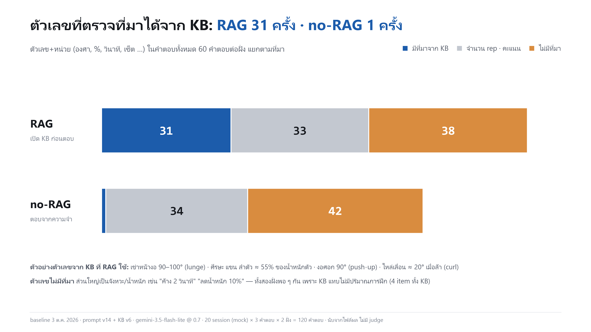
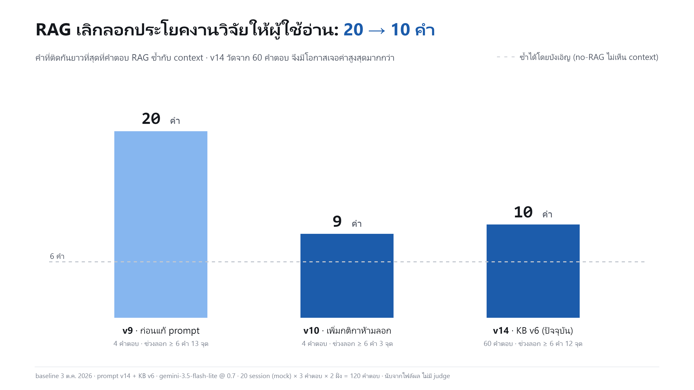
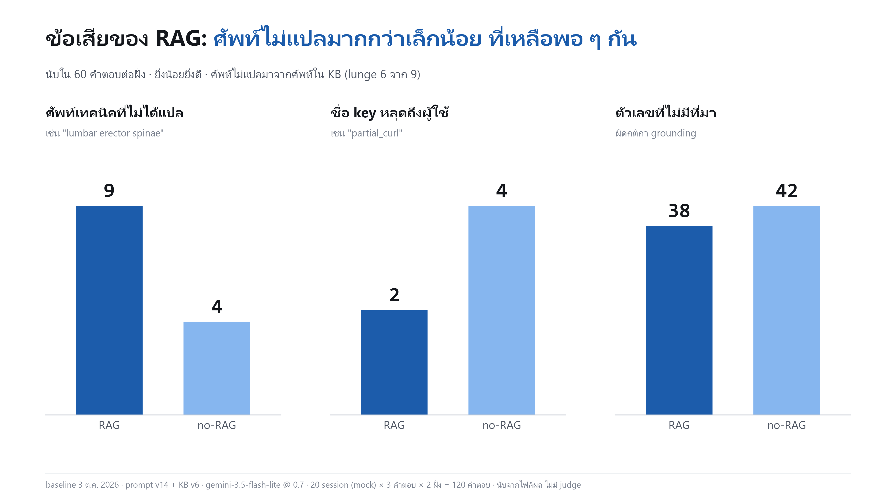

# รายงานผลการประเมินระบบ RAG Feedback: วัดอะไร วัดอย่างไร ได้ผลเท่าไหร่

> รวบรวมเมื่อ 2026-10-20 · branch `rule-change-v6` · commit `6dca811`
> ตัวเลขของระบบปัจจุบัน (หัวข้อ 3) **คำนวณใหม่จากไฟล์ผลในวันที่เขียนเอกสาร** ด้วย `eval/plot_rag_vs_norag.py` และ `eval/eval_generation.py` โดยไม่เรียก LLM และได้ค่าตรงกับที่บันทึกไว้เดิมทุกตัว
> ตัวเลขประวัติการพัฒนา (หัวข้อ 4) ยกมาจาก `docs/reports/metrics_report_2026-09-28.md` และไฟล์ใน `compare_output/` ไม่ได้รันใหม่

---

## 0. สรุป: ผลไหนรายงานได้บ้าง

ผลที่มีอยู่แบ่งได้ 3 กลุ่มตามว่านำไปใช้ในรายงานได้แค่ไหน

| กลุ่ม | ใช้ในรายงานอย่างไร | รายการ | หัวข้อ |
|---|---|---|---|
| **A. ผลหลัก** | รายงานเป็นผลของระบบปัจจุบันได้ทันที (KB v6 · กฎ 12 ข้อ · prompt v14) | ที่มาของตัวเลขในคำตอบ · ศัพท์เทคนิคไม่แปล · การลอกข้อความ · key หลุด · item ข้ามท่า · ความครอบคลุมของ KB ต่อกฎ · การตรวจคุณภาพระหว่างสร้าง KB · ตัวอย่างเชิงคุณภาพ | 3 |
| **B. ประวัติการพัฒนา** | รายงานเป็น "การทดลองระหว่างพัฒนาที่นำไปสู่การออกแบบปัจจุบัน" ได้ แต่ต้องบอกข้อจำกัด เพราะวัดบนระบบรุ่นก่อน (10 อาการ, KB v4/v5) และชุดเฉลยผูกกับถ้อยคำของ KB | golden set · sweep ค่า margin · MiniLM vs Gemini · ablation การค้น R0–R5 · การลอกข้อความ v9 → v10 | 4 |
| **C. ยังรายงานไม่ได้** | มีแค่เครื่องมือหรือแผน ยังไม่มีตัวเลข ให้เขียนเป็น "งานที่จะทำต่อ" | LLM judge แบบ blind pairwise · retrieval recall/precision บน KB v6 ด้วย rule card (E3–E7) · Q-hyde | 5 |

**ข้อความหลักที่อ้างได้จากกลุ่ม A**

1. RAG ทำให้คำตอบมี **ตัวเลขที่ตรวจย้อนกลับไปหาแหล่งใน KB ได้ 31 ครั้ง ขณะที่ no-RAG มี 1 ครั้ง** (จาก 60 คำตอบต่อฝั่ง)
2. ข้อเสียที่วัดได้มีขนาดเล็ก: ศัพท์เทคนิคไม่แปล **9 vs 4** ครั้ง และลอกข้อความจาก context ติดกันยาวที่สุด **10 คำ** (v9 เคยลอก 20 คำ)
3. ไม่มี item ของท่าอื่นปนเข้ามาใน context เลย (**0/201** ชิ้น)
4. KB v6 มีเนื้อหาครบตามเกณฑ์ **9/12 กฎ** อีก 3 กฎที่ขาดเนื้อหาเป็นจุดที่ RAG ให้คำอธิบายผิดกฎ

**สิ่งที่ยังอ้างไม่ได้:** "RAG ให้ feedback ที่ดีกว่า no-RAG" ในภาพรวม เพราะยังไม่มี judge ตัดสินคุณภาพ (หัวข้อ 5.1) ตัวเลขในกลุ่ม A เป็นการนับอัตโนมัติด้านที่วัดได้เท่านั้น

---

## 1. ระบบที่ถูกประเมิน

```
ระบบ 1 (ตรวจท่า)  →  session JSON (error_type = key ของกฎ, ข้อมูลราย rep)
                         │
                         ▼
   B2 แปลง key → คำค้น (Q-spec จาก rule card)
   B3 ค้น KB v6: 3 คำค้น (what / why / fix) × 4 kind, ใช้ item ที่ติดป้ายกฎก่อน
      คัดกรอง: relative margin 0.03 · near-dup Jaccard 0.72 · โควตา 3/2/2/2 (≤ 9 ชิ้นต่อกฎ)
   B4 จัดเป็น context
   B5 LLM เขียน feedback (prompt v14)
```

**คำที่ใช้ในเอกสารนี้**
- **session** = ผลตรวจท่า 1 ครั้งที่ระบบ 1 ส่งมา (ผู้ใช้เล่นท่าเดียว 1 ชุด) เป็น JSON ที่มีชื่อท่า วันที่ สรุป (rep ทั้งหมด/ถูก/ผิด, คะแนนรวม) ผลครั้งก่อน และรายละเอียดราย rep ว่า rep ไหนผิดกฎอะไร ระบบเขียน feedback 1 ชุดต่อ 1 session
- **item** = ประโยคความรู้ 1 ประโยคที่ curator สกัดจากเอกสาร = 1 แถวในฐานข้อมูล แต่ละ item มี kind เดียว (`mistake` / `consequence` / `principle` / `finding`) และติดป้ายกฎได้ 0 ถึงหลายกฎ เมื่อ item ถูกดึงเข้า context จะเรียกว่า "ชิ้น"

| ส่วน | ค่าที่ใช้ |
|---|---|
| Knowledge base | `kb_gemini_curated_v6` 1,845 item (squat 801 · lunge 596 · bicep-curl 283 · push-up 147 · general 18) |
| Embedding | `gemini-embedding-2` บน PostgreSQL + pgvector |
| Curator (สร้าง KB) | `gemini-3.5-flash` |
| ตัวเขียน feedback | `gemini-3.5-flash-lite` @ temperature 0.7 |
| กฎ | 12 กฎ ใน 4 ท่า (squat 4 · lunge 4 · push-up 2 · bicep-curl 2) |

---

## 2. การตั้งการทดลองหลัก: RAG vs no-RAG (baseline v14)

### 2.1 ออกแบบให้ต่างกันแค่ context

| | RAG | no-RAG |
|---|---|---|
| system prompt | v14 | v14 (ตัวเดียวกัน) |
| ข้อมูลผู้ใช้ | session JSON เดียวกัน | session JSON เดียวกัน |
| context | ข้อความจาก KB v6 ที่ค้นตามกฎที่ผิด (6–9 ชิ้นต่อกฎ) | "No external context provided." |
| โมเดล | `gemini-3.5-flash-lite` @ 0.7 | เหมือนกัน |

prompt มีกติกา grounding ที่ใช้กับทั้งสองฝั่ง: **ห้ามใส่ตัวเลข (องศา, %, ผลวิจัย) ที่ไม่มีใน context** · ตัวเลข rep และคะแนนต้องตรงกับ JSON · ห้ามพิมพ์ key ของกฎให้ผู้ใช้เห็น · ศัพท์เทคนิคต้องแปลเป็นภาษาทั่วไปในประโยคเดียวกัน

### 2.2 ข้อมูลทดสอบ

- **mock session 20 ชุด** (`mock_data/mock_sessions_<ท่า>.json`) ต่อท่ามี: กฎละ 1 session ที่ผิดกฎนั้นอย่างเดียว + 1 session ผิดหลายกฎ + 1 session ไม่มีท่าผิด → squat 6 · lunge 6 · push-up 4 · bicep-curl 4
- ตรวจด้วย `build_mock_sessions.py --check` ว่าทุก session เป็นข้อมูลที่ระบบ 1 สร้างได้จริง (เช่น คู่กฎที่ห้ามเกิดใน rep เดียวกัน ลำดับ priority) → **ผ่าน 20/20**
- ขอคำตอบ **3 ครั้งต่อ session** เพราะ temperature 0.7 ให้คำตอบต่างกันทุกครั้ง → **60 คำตอบต่อฝั่ง รวม 120 คำตอบ**
- ไฟล์ผล: `compare_output/baseline_v14/compare_result_v14_<ท่า>.json` / `.md` เก็บค่าที่ตั้ง context ที่ส่งจริง และคำตอบทั้งสองฝั่งวางคู่กัน

---

## 3. กลุ่ม A — ผลหลักของระบบปัจจุบัน

### 3.1 ที่มาของตัวเลขในคำตอบ (number grounding)

**คำถามที่ตอบ:** ตัวเลขเฉพาะที่ระบบบอกผู้ใช้ (องศา, %, วินาที, เซ็ต …) มาจากไหน ตรวจย้อนกลับได้ไหม

**วิธีวัด** (`eval/plot_rag_vs_norag.py` ฟังก์ชัน `number_sources`)

1. ดึงทุก "ตัวเลข + หน่วย" จากคำตอบด้วย regex
   - ตัวเลขเป็นได้ทั้งตัวเลขและคำ ("90", "two") และเป็นช่วงได้ ("90 to 100 degrees")
   - หน่วยที่นับ: วินาที/นาที · เซ็ต/ครั้ง · องศา · % · cm/นิ้ว/นิ้วมือ · kg/lb · สัปดาห์/วัน · ก้าว · ลมหายใจ ฯลฯ
   - จัดหน่วยเป็น 6 ตระกูล: เวลา · มุม · เปอร์เซ็นต์ · ความยาว · น้ำหนัก · จำนวนนับ
2. จัดตัวเลขแต่ละตัวเข้า 1 ใน 3 กลุ่ม
   | กลุ่ม | เงื่อนไข |
   |---|---|
   | **ข้อมูลผู้ใช้** | ตัวเลขที่ตามด้วย "rep" และมีอยู่ใน session JSON หรือเป็น % ที่ตรงกับคะแนนใน JSON |
   | **มีที่มาจาก KB** | ทุกค่าในตัวเลขนั้น (รวมทั้งสองปลายถ้าเป็นช่วง) ปรากฏใน context ของ session นั้นด้วย **ตระกูลหน่วยเดียวกัน** (ไม่นับหัวบรรทัด `[...]` ของ context เพราะมีปีและเลขรูปของเอกสาร) |
   | **ไม่มีที่มา** | ไม่เข้าทั้งสองข้อ |
3. นับรวมทั้ง 60 คำตอบต่อฝั่ง

**ผล**

| กลุ่มของตัวเลข (60 คำตอบต่อฝั่ง) | RAG | no-RAG |
|---|---|---|
| **มีที่มาจาก KB** | **31** | **1** |
| ข้อมูลผู้ใช้ (rep · คะแนน) | 33 | 34 |
| ไม่มีที่มา | 38 | 42 |



ตัวอย่างตัวเลขจาก KB ที่ RAG ใช้: เข่าหน้างอ 90–100° (lunge) · ศีรษะ แขน ลำตัว ≈ 55% ของน้ำหนักตัว · งอศอก 90° (push-up) · ไหล่เลื่อน ≈ 20° เมื่อล้า (bicep curl)

**อ่านผล**
- ความต่างหลักของสองฝั่งอยู่ที่แถวแรก: RAG มีเป้าหมายและเหตุผลเป็นตัวเลขที่มีหลักฐาน ส่วน no-RAG แทบไม่มีเพราะกติกาห้ามคิดตัวเลขเอง
- ตัวเลขไม่มีที่มายังมีมากทั้งสองฝั่ง (38 vs 42) ส่วนใหญ่เป็นจังหวะ/ปริมาณ เช่น "ค้างล่าง 2 วินาที" "ลดน้ำหนัก 10%" เพราะทั้ง KB มีเรื่องปริมาณการฝึกแค่ 4 item (4 ประโยค ไม่ใช่ 4 kind) จึงเป็นข้อจำกัดของ KB ไม่ใช่ของการค้น
  - ตัวเลข 4 ได้จากการสแกนคำสำคัญ ไม่มีสคริปต์บันทึกไว้ · สแกนซ้ำ 2026-10-20 ด้วยคำอย่าง "N sets/reps", "times per week", "rest interval" ได้ 3 item ซึ่งเป็นระดับเดียวกัน
  - 2 ใน 3 เป็นโปรโตคอลของงานวิจัย ไม่ใช่คำแนะนำสำหรับผู้ใช้ ("ฝึก 2 วันต่อสัปดาห์ 10 สัปดาห์", "squat 100 ครั้งต่อวัน 4 เดือนในผู้สูงอายุ") มีที่ใช้ได้จริง 1 item คือ "ยืดกล้ามเนื้อ 2 เซ็ต เซ็ตละ 30 วินาที" (`knee_valgus`)

**ข้อจำกัดของตัววัด:** ตรวจแค่ว่า "ค่าตรงกับ context" ไม่ได้ตรวจว่า "ใช้ถูกบริบท" ตัวอย่างที่ค่าตรงแต่ใช้ผิดอยู่ในหัวข้อ 3.8

### 3.2 ศัพท์เทคนิคที่ไม่ได้แปล (unglossed jargon)

**คำถามที่ตอบ:** RAG ทำให้คำตอบอ่านยากขึ้นเพราะยกศัพท์จากงานวิจัยมาหรือไม่

**วิธีวัด** (`eval/eval_generation.py` ฟังก์ชัน `unglossed_jargon`)

1. รายการคำ `eval/jargon_terms.json`: ศัพท์ที่ต้องแปล 84 คำ (เช่น "lumbar flexion", "valgus", "MVIC") · คำที่ใช้ได้โดยไม่ต้องแปล 24 คำ · คำบ่งชี้ว่ามีคำอธิบาย 15 แบบ
2. ตัดคำตอบเป็นประโยค แล้วจับศัพท์โดยเรียงวลียาวก่อน ("posterior pelvic tilt" นับเป็น 1 คำ ไม่ใช่ 3)
3. ศัพท์นับว่า **แปลแล้ว** ถ้า (ก) มีคำบ่งชี้คำอธิบายตามหลังภายใน 120 ตัวอักษรในประโยคเดียวกัน หรือ (ข) ศัพท์อยู่ในวงเล็บหลังคำธรรมดา เช่น "your lower back rounds (lumbar flexion)"
4. นับศัพท์ที่ไม่ได้แปล
5. ผลซ้ำได้ทุกครั้ง ไม่ใช้ LLM

**ผล**

| ท่า (คำตอบต่อฝั่ง) | RAG | no-RAG |
|---|---|---|
| squat (18) | 0 | 3 |
| push-up (12) | 3 | 0 |
| lunge (18) | 6 | 1 |
| bicep-curl (12) | 0 | 0 |
| **รวม (60)** | **9** | **4** |

**อ่านผล:** RAG มีมากกว่าเล็กน้อย เฉลี่ย 0.15 คำต่อคำตอบ ส่วนใหญ่มาจาก lunge (6 จาก 9) ซึ่งเป็นศัพท์ที่อยู่ใน KB

**ข้อจำกัด:** ตรวจแค่ว่ามีคำอธิบาย ไม่ได้ตรวจว่าอธิบายถูก · รายการคำทำขึ้นเอง ศัพท์ที่ไม่อยู่ในรายการจะไม่ถูกนับ

### 3.3 การลอกข้อความจาก context (longest shared n-gram)

**คำถามที่ตอบ:** LLM นำความรู้มาเรียบเรียงใหม่ให้เป็นภาษาโค้ช หรือลอกประโยคงานวิจัยส่งให้ผู้ใช้

**ที่มาของตัววัด:** รอบ v9 judge ภายนอกตัดสินว่า no-RAG ดีกว่า เพราะ RAG "อ่านเหมือนงานวิจัย" เมื่อแยกอาการออกมาวัดพบว่าสาเหตุคือการลอกประโยค จึงแก้ใน prompt v10 และใช้ตัววัดนี้ยืนยันผลการแก้

**วิธีวัด** (`eval/eval_generation.py` ฟังก์ชัน `shared_spans`)

1. แปลงทั้งคำตอบและ context เป็นลำดับคำพิมพ์เล็ก (ตัดเครื่องหมายและ markdown ออก)
2. หาช่วงคำติดกันที่ยาวที่สุดที่ปรากฏทั้งในคำตอบและ context (longest common substring ระดับคำ)
3. รายงาน 2 ค่า: **ความยาวสูงสุด** และ **จำนวนช่วงที่ยาว ≥ 6 คำ** (ไม่นับช่วงที่ซ้อนกัน)
4. **เส้นฐานความบังเอิญ (chance floor):** วัดฝั่ง no-RAG เทียบกับ context เดียวกันด้วย ฝั่งนี้ไม่เคยเห็น context ความยาวที่ได้จึงเป็นความยาวที่ข้อความสองชิ้นเรื่องเดียวกันซ้ำกันได้โดยบังเอิญ ถ้า RAG ใกล้เส้นนี้แปลว่าไม่ได้ลอก

**ผล**

| รุ่น | คำตอบ RAG ที่วัด | ลอกติดกันยาวสุด | จำนวนช่วง ≥ 6 คำ | no-RAG (เส้นฐาน) |
|---|---|---|---|---|
| v9 (ก่อนแก้ prompt) | 4 | **20 คำ** | 13 | 6 |
| v10 (เพิ่มกติกาห้ามลอก) | 4 | 9 คำ | 3 | 6 |
| **v14 + KB v6 (ปัจจุบัน)** | **60** | **10 คำ** | **12** | < 6 |



**อ่านผล:** v14 มี 12 ช่วงจาก 60 คำตอบ (0.2 ช่วงต่อคำตอบ) เทียบกับ v9 ที่มี 13 ช่วงจาก 4 คำตอบ ช่วงที่ลอกส่วนใหญ่เป็นวลีเป้าหมายสั้น ๆ เช่น "front thigh is parallel to the floor" และ "at full extension and full flexion" ซึ่งเป็นสิ่งที่ prompt อนุญาตให้คงไว้

### 3.4 key ของกฎหลุดถึงผู้ใช้

**วิธีวัด:** ค้นหาชื่อ key ของกฎทั้ง 12 ตัว (เช่น `partial_curl`, `knee_valgus`) แบบข้อความตรงตัวในทุกคำตอบ นับจำนวนคำตอบที่มีอย่างน้อย 1 ตัว (`leaked_keys` ใน `plot_rag_vs_norag.py`)

| | RAG | no-RAG |
|---|---|---|
| คำตอบที่มี key หลุด (จาก 60) | 2 | 4 |

ใน smoke test ก่อนรันเต็ม (`smoke_v14c`) ได้ 0/8 แต่รันเต็ม 120 คำตอบยังหลุด 6 ครั้ง เป็นปัญหาของ prompt ที่เกิดทั้งสองฝั่ง ไม่ใช่ผลของ RAG



### 3.5 item ข้ามท่าใน context (cross-exercise leak)

**คำถามที่ตอบ:** context ของ session squat มีเนื้อหาของท่าอื่นปนมาหรือไม่

**วิธีวัด** (ทำซ้ำได้โดยไม่เรียก API)
1. นำทุกชิ้นใน context ของรายงาน v14 ทั้ง 20 session (201 ชิ้น) มาทำช่องว่างให้เป็นรูปแบบเดียวกัน
2. หาข้อความเดียวกันทั้งประโยคในไฟล์ `curated_data_v6/<ท่า>/` ของท่าตัวเองและของท่าอื่น
3. ใช้การเทียบข้อความตรงตัว ไม่ใช่ similarity เพราะ context ถูกสร้างจากข้อความของ KB โดยไม่ดัดแปลง

| เงื่อนไข | จำนวน |
|---|---|
| พบในโฟลเดอร์ของท่าตัวเอง | **201/201** |
| พบเฉพาะในโฟลเดอร์ท่าอื่น (= leak) | **0** |
| ไม่พบที่ไหนเลย | 0 |

**สิ่งที่ผลนี้บอก:** ป้าย `exercise_id` ตอน ingest ถูก และตัวกรองตอนค้นทำงาน
**สิ่งที่ไม่บอก:** ไม่ได้ตรวจว่าชิ้นนั้นตรงกฎ (ท่าเดียวกันแต่ผิดกฎ = `wrong_fault` ต้องใช้ judge วัด ดูหัวข้อ 5.2)

### 3.6 ความครอบคลุมของ KB ต่อกฎ (tag coverage)

**วิธีวัด:** นับ item ที่ curator ติดป้ายกฎนั้น แยกตาม kind (`mistake` = ลักษณะท่าผิด · `consequence` = ผลเสีย · `principle` = หลักท่าที่ถูก/วิธีแก้ · `finding` = ผลวิจัย) เกณฑ์คือ **≥ 5 item ต่อ kind**

| ท่า | กฎ | mistake | consequence | principle | finding | สถานะ |
|---|---|---|---|---|---|---|
| squat | partial_squat | 8 | 7 | 21 | 25 | ผ่าน |
| squat | knee_valgus | 49 | 42 | 61 | 42 | ผ่าน |
| squat | knee_varus | 14 | 6 | 16 | 13 | ผ่าน |
| squat | rounded_back | 80 | 74 | 116 | 31 | ผ่าน |
| push-up | hip_sag_or_pike | 10 | 8 | 20 | 3 | ผ่าน (finding บาง) |
| push-up | partial_pushup | 2 | 1 | 5 | 2 | **ขาด** |
| lunge | shallow_lunge | 3 | 1 | 9 | 7 | **ขาด** |
| lunge | excessive_front_knee_flexion | 8 | 11 | 9 | 19 | ผ่าน |
| lunge | forward_trunk_lean | 17 | 18 | 20 | 15 | ผ่าน |
| lunge | straight_back_leg | 0 | 0 | 4 | 0 | **ขาดเกือบทั้งหมด** |
| bicep-curl | elbow_flare | 12 | 9 | 13 | 4 | ผ่าน (finding บาง) |
| bicep-curl | partial_curl | 7 | 5 | 23 | 7 | ผ่าน |

**ผล: ผ่าน 9/12 กฎ** · ตัวเลขนี้เป็นของ KB v6 ณ รอบ 2a ที่ ingest แล้ว · รอบ 3 (curate 2026-10-19 ด้วย `gemini-3.6-flash` เพราะ 3.5 เลิกให้บริการ) ยังไม่ ingest และไม่ทำให้ 3 กฎที่ขาดผ่านเกณฑ์ (ยังขาด mistake และ consequence ทั้งสามกฎ)

ใช้ในรายงานเป็นคำอธิบายผลของหัวข้อ 3.8 ได้: กฎที่ KB ขาดเนื้อหาคือกฎที่ RAG ทำได้แย่กว่า no-RAG

### 3.7 การตรวจคุณภาพระหว่างสร้าง KB และระบบ

| ขั้น | ตรวจอะไร | ผล |
|---|---|---|
| rule card | โครงสร้างครบ · ครอบคลุมสเปกระบบ 1 · anchor ไม่ซ้ำถ้อยคำ KB (≥ 5 คำ) | ผ่าน · 0 จุดซ้ำ · ผู้เชี่ยวชาญอนุมัติ 12/12 ใบ (2026-10-02) |
| query (Q-spec) | ไม่ซ้ำถ้อยคำ KB v5 และ anchor (≥ 5 คำ) | 0 จุดซ้ำ |
| คัดไฟล์ก่อน curate | ครบทุกหน่วย · user ตรวจรายการที่ตัด | 102/102 หน่วย · ตัด 31 · 1 ไฟล์กลับเป็นเก็บ |
| curate | โมเดลเดียวกันทุกรอบ · item จาก `general/` จัดท่าถูก · ป้ายข้ามท่า | `gemini-3.5-flash` ทุกครั้ง · ถูก 24/24 (สุ่ม) · ข้ามท่า 0/75 |
| แบ่ง dev/test | สัดส่วนเอกสาร test ต่อกฎ | dev 32 · test 14 เอกสาร · ทุกกฎอยู่ใน test 16–32% |
| ingest | จำนวนแถว = จำนวน item | 1,845 = 1,845 |
| mock | ไม่ขัดสเปกระบบ 1 | 20/20 |
| prompt v14 smoke | key หลุด · ตัวเลข rep/abort ถูก | 0/8 · 8/8 |
| unit test | `tests/test_error_taxonomy.py` ฯลฯ 8 ชุด | ผ่านทั้งหมด (2026-10-03) |

### 3.8 ผลเชิงคุณภาพ (จากการอ่านคำตอบ ไม่ใช่สถิติ)

ใช้เป็นตัวอย่างประกอบตัวเลขในหัวข้อ 3.1–3.6

**(ก) เมื่อ KB มีเนื้อหา RAG อธิบาย "ทำไมสำคัญ" ได้เจาะจงกว่า** · lunge `forward_trunk_lean`

| RAG | no-RAG |
|---|---|
| "Because your upper body makes up **about 55% of your total body weight**, tipping it forward dumps **extra shear stress straight onto your front knee joint** and forces your lower back muscles to work twice as hard …" | "This shifts the work away from your glutes and quads and dumps the load onto your lower back …" |
| ตรงกับ KB: "head, arms, and trunk ≈ 55% of body mass" · "leaning forward … increase the shear force at the knee joint" · กล้ามหลังล่าง 40% vs 20% MVIC | ถูกแต่ทั่วไป ไม่พูดถึงเข่า |

lunge `shallow_lunge`: RAG ให้เป้าหมาย "90 to 100-degree" ที่ผู้ใช้วัดได้ ส่วน no-RAG ไม่มีเป้าหมายเป็นตัวเลข

**(ข) เมื่อ KB ไม่มีเนื้อหา RAG แย่กว่า** · lunge `straight_back_leg` (item ติดป้าย 4 ชิ้น)
- context ได้ 8 ชิ้น ตรงกฎแค่ 1 ชิ้น ที่เหลือเป็นของกฎอื่น (เข่าหน้าเลยปลายเท้า ×2 · หมุนเข่า/เท้า ×2 · หลังงอ/แอ่น)
- **กลไก:** การค้นทำแยกทีละ kind ถ้า kind นั้นมี item ที่ติดป้ายกฎนี้อย่างน้อย 1 ชิ้น จะค้นเฉพาะ item ที่ติดป้าย ถ้าไม่มีเลยจะค้นจาก item ทั้งหมดของท่านั้นแทน (fallback)
  | kind | item ที่ติดป้าย `straight_back_leg` | วิธีค้น | ได้เข้า context |
  |---|---|---|---|
  | mistake | 0 | fallback ทั้งท่า lunge | 3 |
  | finding | 0 | fallback | 2 |
  | consequence | 0 | fallback | 2 |
  | principle | 4 | เฉพาะที่ติดป้าย | 1 |
- ด่าน relative margin เทียบกับ "ชิ้นที่ใกล้ที่สุดในกลุ่มที่ค้น" ชิ้นอันดับต้นจึงผ่านเสมอ แม้กลุ่มนั้นไม่มีเนื้อหาของกฎนี้เลย โควตาจึงถูกเติมด้วยเนื้อหาของกฎอื่นที่ใกล้ที่สุด
- หัวของทุกชิ้นใน context เขียน `re: straight_back_leg` (หัวบอกกฎที่ใช้ค้น ไม่ได้บอกป้ายจริงของ item) LLM จึงถูกบอกว่าทั้ง 8 ชิ้นเป็นเรื่องของขาหลังเหยียด
- RAG: "This puts extra **rotational twisting stress** straight onto your knee joints …" ← เหตุผลของ "เข่าบิด" ไม่ใช่ "ขาหลังเหยียด"
- no-RAG: "When your back leg stays locked out, your hips and front quad have to shoulder extra strain …" ← ตรงประเด็นกว่า
- สรุป: เมื่อ KB ขาด ระบบไม่ได้ context ว่าง แต่ได้เนื้อหาของกฎอื่นมาแทน

**(ค) ข้อบกพร่องของ RAG ที่พบจากการอ่าน**
- ขยายตัวเลข: "nearly double the muscular demand" ทั้งที่ KB ให้ 0.980 vs 0.717 Nm/BW (≈ 1.4 เท่า)
- ส่งสถิติงานวิจัยให้ผู้ใช้: 1 ใน 3 คำตอบของ `forward_trunk_lean` เขียน "40 ± 29% … 20 ± 15%"
- อ่านผลวิจัยผิด: "ไหล่เลื่อน 20° ที่ 20% ของรอบท่า" ถูกเขียนเป็น "near the bottom of the movement" 1 คำตอบ

**(ง) ส่วน "แก้ยังไง" สองฝั่งคล้ายกัน** เช่น `knee_valgus` ทั้งสองฝั่งแนะนำยางยืดรอบเข่า เพราะ LLM รู้วิธีแก้ท่าผิดที่พบบ่อยอยู่แล้ว และ KB มีเนื้อหาวิธีแก้แบบลงมือทำน้อยนอกจาก squat

---

## 4. กลุ่ม B — ประวัติการพัฒนา (ระบบรุ่นก่อน)

> **ต้องเขียนกำกับในรายงาน:** ตัวเลขกลุ่มนี้วัดบน taxonomy 10 อาการเดิมและ KB v4/v5 เทียบกับตัวเลขของ KB v6 ตรง ๆ ไม่ได้ และชุดเฉลย (golden set) เขียนโดยตัดข้อความมาจาก KB v4 ซึ่งเป็นเหตุผลที่ต้องออกแบบ eval ใหม่สำหรับ v6 (หัวข้อ 5.2) ใช้กลุ่มนี้เพื่อแสดงว่า **ค่าที่ตั้งในระบบปัจจุบันมาจากการทดลอง** และเห็นทิศทางของการปรับ ไม่ใช่เป็นผลสุดท้าย

### 4.1 Golden set: เลือก embedding และค่า margin

**วิธีวัด** (`eval/eval_retrieval.py` + `eval/golden_chunks.json`)
- ชุดเฉลยที่คนเขียน ต่ออาการมี `must_hit` (pattern ของข้อความที่ควรได้) และ `must_not_hit` (pattern ของอาการอื่นที่ห้ามติดมา)
- นับ chunk ที่ผ่านด่านคัดกรองเข้า context จริง

| ตัววัด | ความหมาย |
|---|---|
| hit | จำนวนอาการที่ได้ `mistake` ถูกอย่างน้อย 1 ชิ้น |
| good / bad / neutral | ตรง `must_hit` / ตรง `must_not_hit` / ไม่ตรงทั้งคู่ |
| precision | good ÷ kept |

**bad เป็นตัวที่สำคัญที่สุด** เพราะเป็นข้อมูลของอาการอื่นที่ติดป้ายว่าเป็นอาการนี้ ซึ่งทำให้ LLM อธิบายผิด

**ผล: sweep relative margin (Gemini, KB v4, mode single)** → ที่มาของค่า 0.03 ในระบบปัจจุบัน

| margin | kept | good | bad |
|---|---|---|---|
| 0.06 | 68 | 25 | 6 |
| 0.04 | 65 | 24 | 4 |
| **0.03 (เลือก)** | **62** | **23** | **2** |
| 0.015 | 53 | 20 | 2 |
| 0.01 | 51 | 19 | 1 |

แคบกว่า 0.03 bad ไม่ลดเพิ่ม มีแต่เสีย good

**ผล: MiniLM vs Gemini (KB v4)**

| mode | embedding | hit | kept | good | bad | neutral | precision |
|---|---|---|---|---|---|---|---|
| single | MiniLM (margin 0.06) | 9/10 | 47 | 33 | 9 | 5 | 0.70 |
| single | Gemini (margin 0.03) | 8/10 | 62 | 23 | **2** | 37 | 0.37 |
| session | MiniLM | 5/6 | 27 | 20 | 6 | 1 | 0.74 |
| session | Gemini | 4/6 | 38 | 12 | **5** | 21 | 0.32 |

อ่านผลอย่างระวัง: bad ลดลง (9 → 2) แต่ precision ตกเพราะ neutral พุ่ง (5 → 37) ซึ่งเกิดจากเฉลยเขียนตามถ้อยคำที่ MiniLM เคยดึง ไม่ได้แปลว่า Gemini ดึงของผิด ตอนนั้นสรุปไว้ว่า "ยังตัดสินไม่ได้จากตัวเลขอย่างเดียว" · ที่ margin 0.06 เท่ากัน Gemini ได้ bad 6 (MiniLM 9) ส่วนที่ลดจาก 6 → 2 มาจากการจูน margin

**ผล: KB v5** (หลังเพิ่มถ้อยคำ v5 ในเฉลย แก้ tag และถอดเอกสารที่ไม่ตรง) → hit **10/10** · precision **0.62** · bad **1**

### 4.2 Relevance pool: ablation การค้น R0–R5

**วิธีวัด** (`eval/eval_retrieval.py --pool`)
1. ให้ LLM (`gemini-3.8-flash`) ติดป้าย 1,256 candidate ว่าเกี่ยวกับอาการไหน (`relevant` / `wrong_fault` / `irrelevant`)
2. รวมประโยคที่เกือบซ้ำ (Jaccard 0.72) ได้ **411 relevant facts** เป็นตัวหาร
3. ตัววัด: **recall** (facts ที่ดึงได้ ÷ 411) · **ceiling** (recall สูงสุดที่เป็นไปได้ภายใต้งบ 9 ชิ้นต่ออาการ = 0.21) · **pool-precision** (relevant ÷ kept) · **wrong_fault** ใน context · สาเหตุที่ fact หลุด
4. **เกณฑ์เก็บขั้น (ตั้งก่อนรัน ต้องผ่านทุกข้อ):** recall ขึ้น · wrong_fault ไม่เพิ่ม · golden bad ไม่เพิ่ม · pool-precision ไม่ตกเกิน 0.05

| ขั้น | เปลี่ยน | recall micro / macro | facts | wrong_fault | pool-precision | ผล |
|---|---|---|---|---|---|---|
| R0 | แก้ tag สะกดผิดใน DB | 0.15 / 0.26 | 62 | 6 | 0.79 | ✅ เก็บ |
| R1 | tag แบบ union | 0.14 / 0.24 | 57 | 6 | 0.71 | ❌ precision ตก |
| R2 | รวม pool ทุก kind | 0.07 / 0.10 | 28 | 2 | 0.90 | ❌ recall ตกครึ่ง |
| **R4** | **คำค้น 3 มุม what/why/fix** | **0.16 / 0.27** | **66** | **6** | **0.80** | ✅ **ใช้ในระบบปัจจุบัน** |
| R5 | hybrid BM25 | 0.16 / 0.26 | 65 | 8 | 0.79 | ❌ wrong_fault เพิ่ม |
| R6 | reranker | — | — | — | — | ⏸ RAM ไม่พอ |

**อ่านผล:** R4 เพิ่ม recall โดยไม่เพิ่ม wrong_fault และได้ golden bad 0 · ตัวกั้น recall อันดับหนึ่งคือโควตาต่อ kind (210 facts) ไม่ใช่คุณภาพการค้น

**ข้อจำกัด:** judge เป็น Gemini ค่ายเดียวกับ curator และได้เห็น query ที่ใช้ค้นเป็นเกณฑ์ตัดสิน (วงจรปิด) · paraphrase ถูกนับเป็นหลาย fact จึงทำให้ recall ต่ำกว่าความจริง แต่ยังเทียบระหว่างขั้นได้เพราะตัวหารเท่ากัน

### 4.3 ผลของการแก้ prompt (v6 → v7 และ v9 → v10)

| การแก้ | ตัววัด | ก่อน | หลัง |
|---|---|---|---|
| prompt v6 → v7 (4 session) | ประโยคที่ยืนยันผิด | 4 | 0 |
| | "วิธีแก้" ที่อ้างหลักการจาก KB | 0/3 session | 3/3 session |
| prompt v9 → v10 (4 session) | ศัพท์เทคนิคไม่แปล (RAG) | 17 | 1 |
| | ลอก context ติดกันยาวสุด (RAG) | 20 คำ | 9 คำ |

---

## 5. กลุ่ม C — ยังรายงานเป็นตัวเลขไม่ได้

### 5.1 LLM judge แบบ blind pairwise (คุณภาพของ feedback)

ตัวนี้ตอบคำถามหลักของโปรเจกต์ ("feedback จาก RAG ดีกว่าไหม") ซึ่งตัววัดในกลุ่ม A ตอบไม่ได้

**สถานะ:** เครื่องมือ `eval/judge_pairwise.py` เสร็จแล้ว ค่าเริ่มต้นของ judge เปลี่ยนเป็น `cerebras:gpt-oss-120b` (ต่างค่ายจาก Gemini ที่ใช้เขียนและ curate) · ส่งออกคู่ตัวอย่าง 1 คู่ไว้ที่ `sample_pairwise/` · **ยังไม่มีคำตัดสินจากการรันเต็ม**

**วิธีวัดที่จะใช้**
1. จับคู่คำตอบของ session เดียวกัน: คำตอบที่ i ของ RAG กับคำตอบที่ i ของ no-RAG → 20 session × 3 = 60 คู่
2. สุ่มซ้าย/ขวาต่อคู่ (seed คงที่) ไม่บอก judge ว่าอันไหนมาจากระบบไหน
3. judge เห็น session JSON และคำตอบ 2 ชุด **ไม่เห็น context** (เพราะจะเผยว่าฝั่งไหนเป็น RAG)
4. ตัดสิน 4 เกณฑ์ตาม SportsGPT + overall ว่าฝั่งไหนดีกว่าหรือเสมอ
   | เกณฑ์ | ความหมาย |
   |---|---|
   | accuracy | ถูกต้อง ตัวเลขตรง JSON ไม่แต่งตัวเลข |
   | comprehensiveness | ครบทุกท่าผิด อธิบายสาเหตุ/ผลต่อผู้ใช้ ใช้ข้อมูลราย rep |
   | professionalism | เฉพาะเจาะจงกับท่าผิดนั้น ไม่ใช่คำแนะนำทั่วไป |
   | feasibility | ทำตามได้จริง มี cue/ชุด/จำนวน |
5. ถอดการสุ่มกลับ นับชนะ/แพ้/เสมอรายเกณฑ์ แล้วใช้ **sign test** (binomial สองข้าง ตัด tie) ต้องได้ p < 0.05 จึงอ้างว่าต่างกัน
6. ตัวป้องกันความเอนเอียง: **position check** (judge เลือกซ้าย/ขวาใกล้ 50% ไหม) · รันทั้งแบบ judge ไม่เห็นหลักฐาน (`--reference none`) และเห็นหลักฐานจาก KB (`union`) เพราะ smoke test พบว่า judge ที่ไม่เห็นหลักฐานตัดสินคำแนะนำจริงจาก KB ว่า "เกินจริง"

**สิ่งที่ต้องทำก่อนรายงาน:** ตั้งเกณฑ์อ่านผลไว้ก่อนรัน · ประเมินค่า API แล้วขออนุมัติ · ไม่แก้ judge prompt หลังเห็นผล

### 5.2 Retrieval eval บน KB v6 ที่ไม่ผูกกับถ้อยคำ KB (แผน E3–E7)

แทนที่ golden set ของหัวข้อ 4.1 ซึ่งมีปัญหาเฉลยผูกกับถ้อยคำ KB (รายละเอียดใน `docs/plans/eval_v6_plan.md`)

| ส่วน | สถานะ |
|---|---|
| E1 rule card 12 ใบ + anchor 173 ประโยค ผู้เชี่ยวชาญอนุมัติ | ✅ เสร็จ (เป็นเฉลยที่นิยามก่อนมี KB v6 ประวัติ git ยืนยันลำดับได้) |
| E2 Q-spec | ✅ ยืนยันแล้ว · Q-hyde ยังไม่ทำ (รอ key ค่ายที่ไม่ใช่ Gemini) |
| E5 แบ่ง dev/test ตามเอกสาร | ✅ เสร็จ |
| E3 candidate pool แบบ TREC pooling | ยังไม่ทำ |
| E4 judge 3 ค่าย (gate: accuracy บน anchor ≥ 90%, Fleiss' κ ≥ 0.6) | ยังไม่ทำ |
| E6 baseline บน dev + test ครั้งเดียว | ยังไม่ทำ |
| E7 เทียบ query และวัด overfit (dev − test) | ยังไม่ทำ |

ตัวเลขที่จะได้เมื่อทำครบ: recall · precision · **wrong_fault rate** ต่อกฎ พร้อม bootstrap 95% CI · accuracy ของ judge บน anchor · κ ระหว่าง judge

ในรายงานตอนนี้เขียนได้แค่ **วิธีการและเหตุผลที่ออกแบบแบบนี้** ยังไม่มีผล

---

## 6. ข้อจำกัดที่ต้องเขียนในรายงาน

1. **ยังไม่มีการตัดสินคุณภาพโดยรวม** ตัวเลขกลุ่ม A ทั้งหมดเป็นการนับอัตโนมัติ บอกได้ว่าคำตอบมีหลักฐาน/อ่านง่าย/ไม่ลอก แต่ไม่ได้บอกว่าเป็นโค้ชที่ดีกว่า
2. **ข้อมูลทดสอบเป็น mock 20 session** ไม่ใช่ผู้ใช้จริง และ 3 คำตอบต่อ session ยังน้อยสำหรับการทดสอบทางสถิติ
3. **ไม่มี item หรือ chunk ใดถูกตรวจด้วยคน** ชุดคำตอบเดียวที่คนรับรองคือ anchor 173 ประโยค (ประโยคที่เขียนขึ้น ไม่ใช่ item จริง)
4. **โมเดลค่ายเดียวกันหลายจุด:** curator, ตัวเขียน feedback และ judge ของ relevance pool (หัวข้อ 4.2) เป็น Gemini ทั้งหมด
5. **ตัวเลข "มีที่มาจาก KB"** ตรวจแค่ค่าและหน่วยตรงกับ context ไม่ได้ตรวจว่าใช้ถูกบริบท
6. **รายการศัพท์เทคนิค** ทำขึ้นเองในโปรเจกต์
7. **KB v6 หยุดที่รอบ 2a:** 3 กฎเนื้อหาไม่ถึงเกณฑ์ ผลที่แย่ในกฎเหล่านี้ควรรายงานเป็น data gap ไม่ใช่ความผิดของการค้น
8. **ค่าคัดกรองหลายค่าไม่ได้วัดใหม่บน KB v6:** margin 0.03 วัดบน KB v4 · Jaccard 0.72 และโควตา 3/2/2/2 สืบทอดจากรุ่นก่อน
9. **มีขั้นคัดไฟล์โดย Claude ก่อน curate** (102 หน่วย ตัด 31 เหตุผลอยู่ใน `data_pipeline/prefilter_v6.json`)
10. **`state_occurred` ยังไม่ส่งให้ LLM** และรูปแบบ abort ยังเป็นสมมติฐานที่รอยืนยันกับระบบ 1

---

## 7. วิธีรันซ้ำ (ไม่เรียก API)

```bash
# ตัวเลขหัวข้อ 3.1–3.4 + รูปทั้ง 3 รูป (ได้ค่าเดิมทุกครั้ง)
PYTHONIOENCODING=utf-8 python eval/plot_rag_vs_norag.py

# ศัพท์ไม่แปลและการลอกข้อความ แยกต่อคำตอบ (หัวข้อ 3.2–3.3)
python eval/eval_generation.py compare_output/baseline_v14/compare_result_v14_squat.md --mock mock_data/mock_sessions_squat.json
#   เปลี่ยน squat เป็น push-up / lunge / bicep-curl · เพิ่ม --show-hits เพื่อดูคำที่ถูกนับ

# ความถูกต้องของ mock และการแบ่ง dev/test (หัวข้อ 3.7)
python mock_data/build_mock_sessions.py --check
python eval/make_split.py --check
python eval/check_rule_cards.py --queries
```

## 8. ไฟล์ที่มาของตัวเลข

| หัวข้อ | ไฟล์ |
|---|---|
| 3.1–3.5, 3.8 | `compare_output/baseline_v14/compare_result_v14_<ท่า>.json` / `.md` · `docs/slides/rag_vs_norag_slides_2026-10-03.md` |
| 3.6–3.7 | `docs/progress/v6_workflow_summary_2026-10-03.md` §5.5–5.7, §7 · `docs/progress/t3_curation_status.md` |
| 4.1 | `docs/kb/kb_quality_assessment.md` §7, §9–§11 · `compare_output/retrieval/golden_*.md` |
| 4.2 | `compare_output/ablation/ablation_log.md` · `compare_output/ablation/ablation_{B0,R0,R1,R2,R4,R5}_retrieval.md` |
| 4.3 | `compare_output/history/generation_v9_vs_v10.md` · `docs/kb/kb_quality_assessment.md` §7.3, §12 |
| 5 | `eval/judge_pairwise.py` · `sample_pairwise/` · `docs/plans/eval_v6_plan.md` |
| รวมทุก metric ช่วงก่อน v6 | `docs/reports/metrics_report_2026-09-28.md` |
